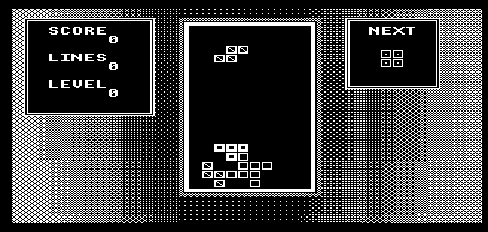

# Lobo MAX-80

An emulator and new software for the Lobo MAX-80, a Z80 business
computer from 1982, built by Lobo Systems of Goleta, California. It is
software compatible with the TRS-80 Model III but not hardware
compatible. It came with CP/M 2.2, later CP/M 3, and LDOS.

- CPU: Z80B at about 5 MHz (15.2 MHz crystal divided by 3).
- RAM: 64K, expandable to 128K, banked in 32K halves.
- Video: 80 x 24 text through an HD46505 CRTC. There is no character
  ROM. The font sits in a 2K RAM and is loaded from the boot disk.
- Disks: an MB8876 controller with connectors for 5.25" and 8" drives,
  and a SASI port for a hard disk.
- I/O: two RS-232 ports (Z80 SIO), a Z80 PIO, a printer port, an
  MSM5832 clock and an expansion port.
- ROM: a 512-byte boot ROM that reads one sector and runs it.

The rest of the MAX-80 software I wrote has its own repos, and all of
it runs in this emulator:

- [max80_xcpmz80](https://github.com/fletto2/max80_xcpmz80): a CP/M
  compatible OS that keeps its files on FAT12 disks, so a PC reads and
  writes them, with a loader for ZX81 machine code games.
- [max80_cprograms](https://github.com/fletto2/max80_cprograms): C
  programs for xcpmz80, MicroEMACS, STEVIE (vi), Colossal Cave
  Adventure, MojoZork and file transfer as base64 text, with a C
  library resident in the upper 64K.
- [max80_clonerunner](https://github.com/fletto2/max80_clonerunner):
  Clone Runner, a dig-and-climb game for xcpmz80, a port of Lode
  Runner. The original's stages are not included.
- [max80_diagrom](https://github.com/fletto2/max80_diagrom): the
  diagnostic disk and the boot disk monitor.
- [max80_monitor](https://github.com/fletto2/max80_monitor): the
  monitor on its own.

## What is here

- `emu/`: the emulator, in C. It boots the original CP/M 2.2, CP/M 3
  and LDOS disks, and everything above. It draws in an SDL2 window, or
  in the terminal without SDL2. `emu/frame2png.py` turns a frame saved
  by its `-p` into a PNG.
- `port/`: Tetris, the Game Boy game, ported to the MAX-80 for
  xcpmz80. The source is ours. The game's numbers are lifted from your
  own copy of the cartridge when you build it, so no byte of
  Nintendo's is included. It needs max80_xcpmz80 checked out beside
  this repo. Its `README.md` says how.
- `tools/`: disk image converters, `.imd` to raw sectors and DMK to
  `.imd`.
- `reference/rom/max80.e12`: Lobo's v1.3 boot ROM, 512 bytes, included
  for the emulator.

The Tetris port in the emulator:



## Disk images

The disks built from this source are on archive.org, ready for the
emulator or a real machine, as
[Lobo Max80 homebrew software](https://archive.org/details/lobo-max80-homebrew_202611).
The original Lobo disks, CP/M 2.2, CP/M 3, LDOS and the applications
that came with them, are at
[lobo-max80-software](https://archive.org/details/lobo-max80-software).

## Building

Linux, or any system with a C compiler and make, and SDL2 for the
window (optional):

```sh
make -C emu
cd emu
./max80 -a DISK.imd
```

Ctrl-] quits. `-D 1` boots a 5.25" disk. `make test` runs the tests,
and `emu/README.md` lists every option. The Tetris port also needs
[sjasmplus](https://github.com/z00m128/sjasmplus) and Python 3.

## License

The emulator and the Tetris port are MIT, in each folder's `LICENSE`.
The scripts in `tools/` are MIT on the terms in `emu/LICENSE`.
