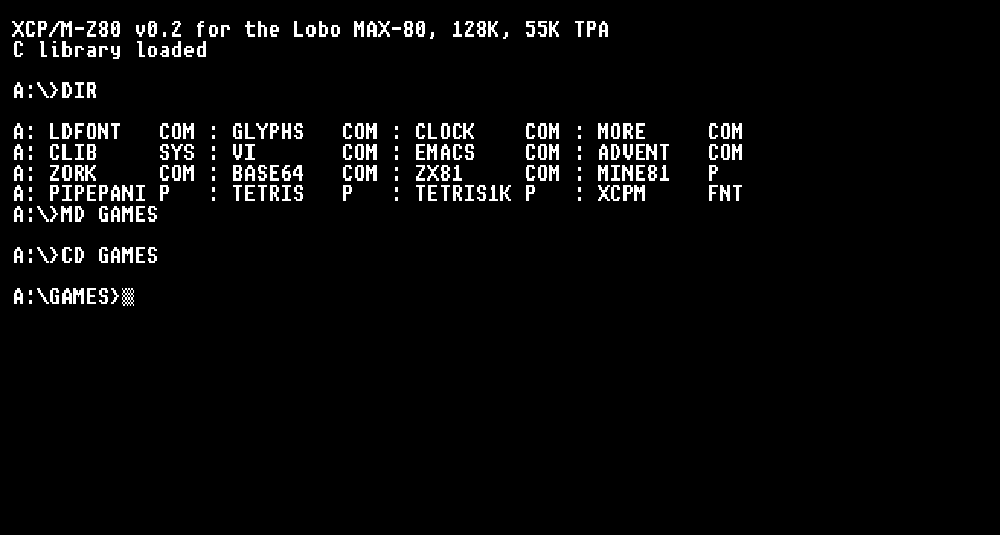
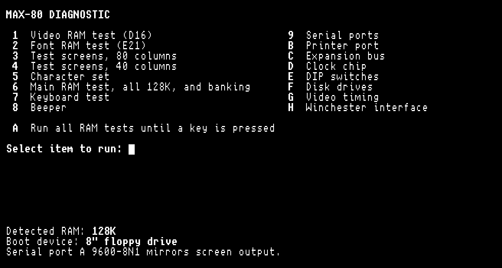
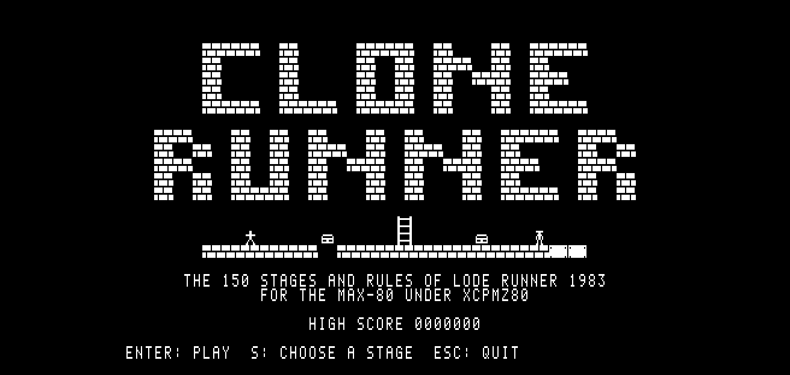
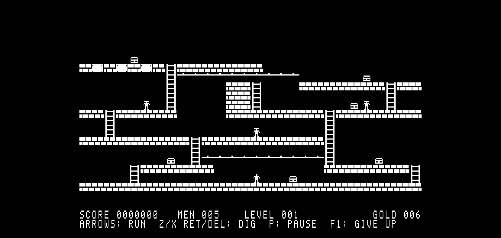
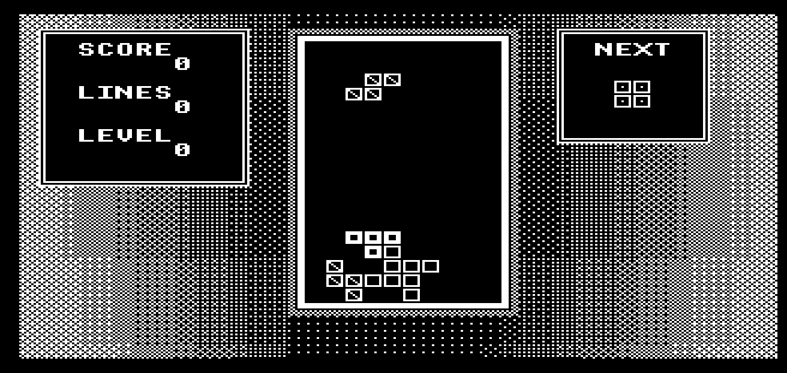
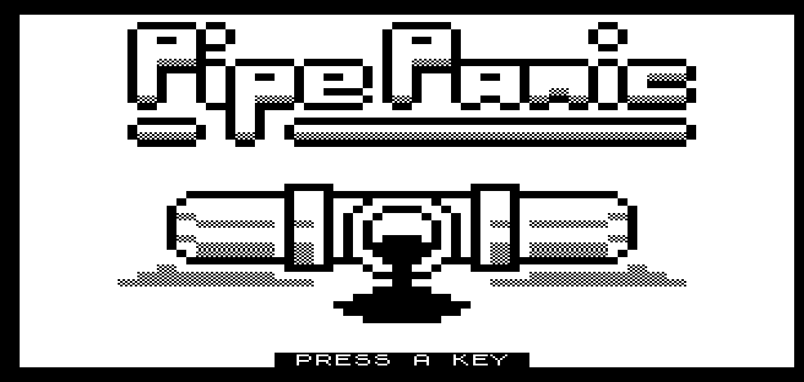
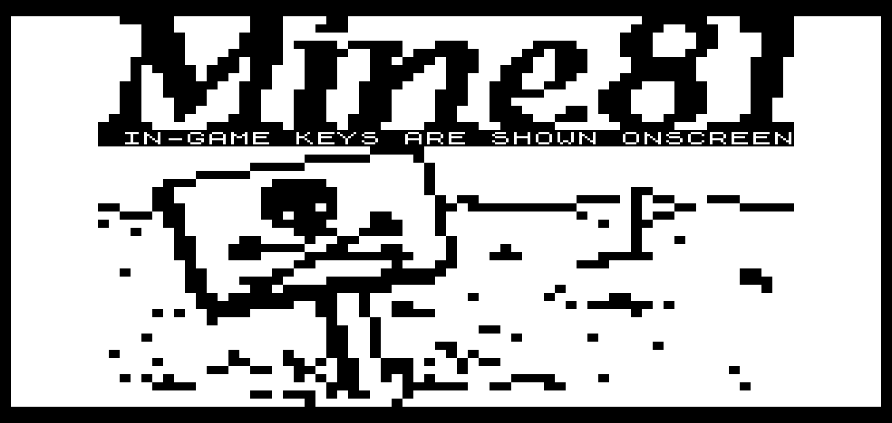

# Lobo MAX-80

An emulator and new software for the Lobo MAX-80, a Z80 business
computer from 1982, built by Lobo Systems of Goleta, California. It is
software compatible with the TRS-80 Model III but not hardware
compatible. It came with CP/M 2.2, later CP/M 3, and LDOS.

- CPU: Z80B at about 5 MHz (15.2 MHz crystal divided by 3).
- RAM: 64K, expandable to 128K, banked in 32K halves.
- Video: 80 x 24 text through an HD46505 CRTC. There is no character
  ROM. The font sits in a 2K RAM and is loaded from the boot disk.
- Disks: an MB8876 controller with connectors for 5.25" and 8" drives,
  and a SASI port for a hard disk.
- I/O: two RS-232 ports (Z80 SIO), a Z80 PIO, a printer port, an
  MSM5832 clock and an expansion port.
- ROM: a 512-byte boot ROM that reads one sector and runs it.

## Screenshots

From the emulator. xcpmz80 with its programs, and a folder made and
entered:



The diagnostic disk's menu:



Clone Runner's title, and its first stage in play:





The Game Boy Tetris port, in `port/`, which you build from your own
copy of the cartridge:



ZX81 games under xcpmz80's ZX81.COM, Pipepanic and Mine81:





## What is here

- `emu/`: the emulator, in C. It boots the original CP/M 2.2, CP/M 3
  and LDOS disks, and everything below. It draws in an SDL2 window, or
  in the terminal without SDL2.
- `diag/`: a diagnostic boot disk with no OS. It tests video RAM, font
  RAM, main RAM, banking, the keyboard, the drives, video timing, the DIP
  switches, the serial and printer ports, the clock and the expansion
  bus.
- `monitor/`: a machine code monitor on its own boot disk: dump, edit,
  fill, move, search, go, S-records over the serial port, a RAM test.
- `xcpmz80/`: a CP/M compatible OS that keeps its files on FAT12 disks,
  so a PC reads and writes them. Its apps disk has MicroEMACS, STEVIE
  (vi), Colossal Cave Adventure, MojoZork, a C library resident in the
  upper 64K, file transfer as base64 text, and a loader for ZX81
  machine code games.
- `software/clonerun/`: Clone Runner, a dig-and-climb game for
  xcpmz80, a port of Lode Runner. The original's stages are not
  included. `build.sh` reads them from a file you supply, as described
  in its `README.md`.
- `port/`: Tetris, the Game Boy game, ported to the MAX-80 for CP/M
  2.2 and xcpmz80. The source is ours. The game's numbers are lifted
  from your own copy of the cartridge when you build it, so no byte
  of Nintendo's is included. Its `README.md` says how.
- `tools/`: disk image converters, `.imd` to raw sectors and DMK to
  `.imd`, and the maker of the ZX81 loader's test files.
- `screenshots/`: the pictures above. `make.sh` makes them again from
  the emulator, with `emu/frame2png.py`, which turns a frame saved by
  the emulator's `-p` into a PNG.
- `reference/rom/max80.e12`: Lobo's v1.3 boot ROM, 512 bytes, included
  for the emulator.

The `README.md` in each of `emu/`, `diag/`, `monitor/`, `xcpmz80/` and
`software/clonerun/` says how to build it, test it and use it.

## Disk images

The disks built from this source are on archive.org, ready for the
emulator or a real machine, as
[Lobo Max80 homebrew software](https://archive.org/details/lobo-max80-homebrew_202611).
The original Lobo disks, CP/M 2.2, CP/M 3, LDOS and the applications
that came with them, are at
[lobo-max80-software](https://archive.org/details/lobo-max80-software).

## Building

Linux, or any system with these:

- A C compiler and make, and SDL2 for the window (optional).
- [sjasmplus](https://github.com/z00m128/sjasmplus) for the Z80 code.
- Python 3.
- SDCC 4.6.0 for the C programs on the xcpmz80 apps disk.
- mtools for the xcpmz80 tests.

```sh
make -C emu
make -C xcpmz80
cd emu
./max80 -K -a ../xcpmz80/build/xcpmz80.imd
```

Ctrl-] quits the emulator. `./max80 -a DISK.imd` boots one of Lobo's
own disks. `-D 1` boots a 5.25" disk. `make test` in each folder runs
its tests.

## License

The emulator, diag, monitor, xcpmz80, Clone Runner and the Tetris port
are MIT, in each folder's `LICENSE`. The scripts in `tools/` are MIT on the terms
in `emu/LICENSE`. The programs on the xcpmz80 apps disk keep
their own licenses, given in `xcpmz80/README.md` and beside each one:
MicroEMACS 3.6, STEVIE and Colossal Cave Adventure are public domain,
MojoZork is zlib, the console font is public domain, and of the ZX81
games, Mine81 and the Tetris games are public domain and Pipepanic is
GPL 3.
